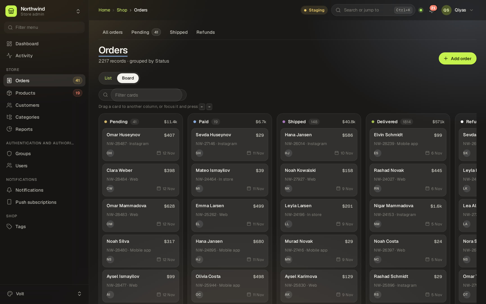

# Board

Any model with a status, a stage or a foreign key to a list of stages can be shown as a board: one column per value, one card per record. Cards are dragged to another column, or moved with the arrow keys, and the change is saved straight away.



## Turning it on

Set `board_field` on the model admin. It can be a field with `choices` or a foreign key.

```python
from cc_admin.admin import ModelAdmin


@admin.register(Order)
class OrderAdmin(ModelAdmin):
    board_field = "status"
    board_title = "customer__name"
    board_subtitle = "board_line"
    board_value = "total"
    board_prefix = "$"
    board_date = "created_at"
    board_avatar = "customer__name"
    board_tones = {"pending": "sand", "paid": "blue", "shipped": "plum", "delivered": "olive", "cancelled": "rust"}

    def board_line(self, obj):
        return f"{obj.number} · {obj.get_channel_display()}"
```

The list page then gets **List** and **Board** buttons above the table. The board lives at `<model>/cc-board/`.

## What goes on a card

Every `board_*` option takes a field name, a path across relations with `__`, a method on the model admin or a callable that receives the object.

| Option | Meaning |
| --- | --- |
| `board_field` | The field that makes the columns. Choices are used in their order. For a foreign key, the first 30 related objects become columns. |
| `board_title` | The card title. Defaults to `str(obj)`. |
| `board_subtitle` | A muted line under the title. |
| `board_value` | A number shown on the card and summed in the column header. A model field is summed in the database; anything else is summed in Python. |
| `board_prefix`, `board_suffix` | Text around the value, like `$`. |
| `board_date` | A date shown at the bottom right. |
| `board_avatar` | A user (initials from the full name), a name (initials) or an image URL. |
| `board_tones` | Colour of each column's dot, by value: a tone name (`accent`, `success`, `warning`, `danger`, `info`, `neutral`, `blue`, `olive`, `rust`, `sand`, `plum`) or any CSS colour. Columns without one take a colour in turn. |
| `board_limit` | Cards per column. Default 50. The rest is counted under the column. |

## Filters and search

The board uses the same filters and search as the list. Open the board from a filtered list and it keeps the filter. The box above the board narrows the cards on the page as you type.

## Moving cards

Drag a card onto another column, or focus it with Tab and press the left or right arrow. Enter opens the record. The card moves at once and the column totals update when the server answers. If the save fails, the card goes back and an error toast says so.

Moving needs the change permission for that record (`has_change_permission(request, obj)`). Users who can only view see the board without dragging. Every move is saved with `save(update_fields=[field])` and written to the history like any other change.
